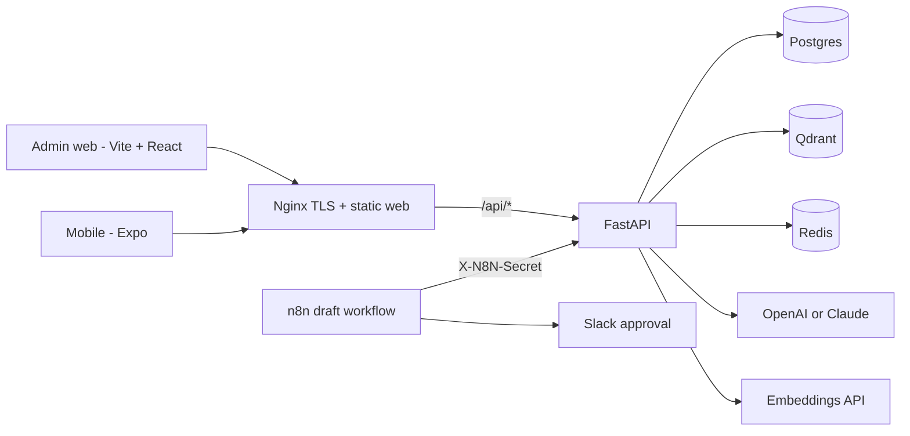
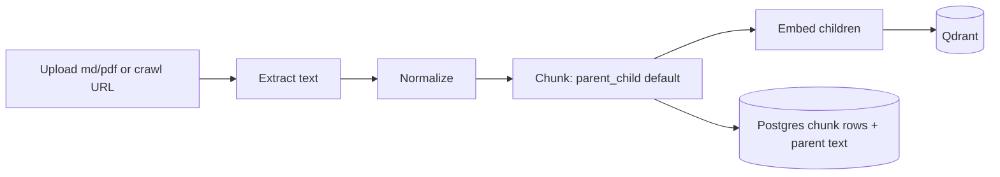
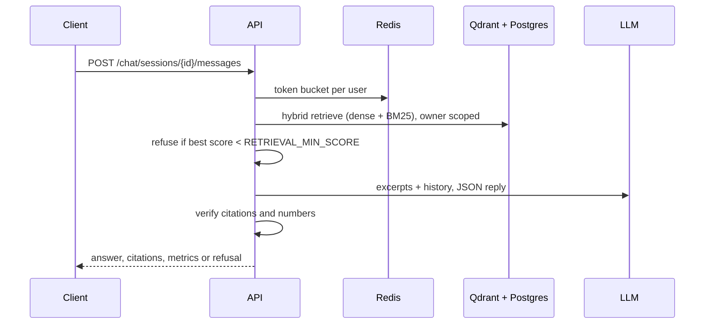
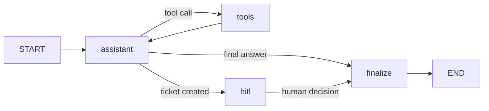
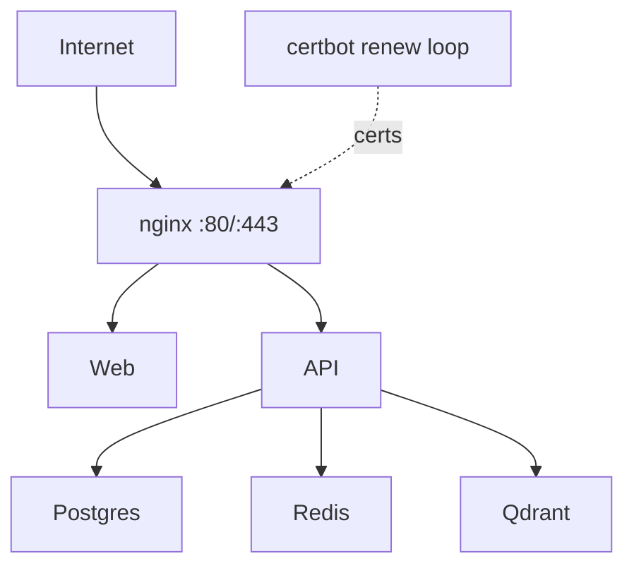

# Architecture

SMB Support Knowledge Copilot answers customer-support questions from a business's own documents.
Every answer carries citations, the system refuses when evidence is missing, and risky actions pause for a human.

## System overview

| Component | Role |
| --- | --- |
| `backend/` (FastAPI, Python 3.12) | Auth, ingestion, retrieval, chat, agent, tickets, draft API |
| Postgres | Source of truth: users, documents, chunk rows, chat messages, tickets |
| Qdrant | Dense vectors, filtered by owner |
| Redis | Rate limit token buckets, health check |
| `web/` | Admin UI: ingest, chunk inspection, chat, ticket approval |
| `mobile/` | Thin Expo client for chat and tickets, no on-device AI |
| `n8n/workflows/draft-reply.json` | Webhook, draft API call, Slack post |
| `deploy/` | Local Compose, VPS overrides, Nginx configs |

## Flow 1: ingestion

- Uploads are capped at 10 MB in the API and 11 MB in Nginx.
- URL crawling validates that the target is a public host before fetching.
- Chunking strategies are `fixed`, `heading`, and `parent_child`.
  The default is `parent_child` (128 token children, 512 token parents).
  The decision and numbers live in `chunking-decision-record.md`.
- Postgres stores each chunk with section, strategy, and the Qdrant point ID.

## Flow 2: grounded answer (RAG mode)

1. Rate limit: a Redis Lua token bucket per user (see Hardening).
2. Retrieve: Qdrant dense hits plus BM25 over the same user's chunks.
   Single-channel hits keep that channel's score; both-present hits use a true weighted sum with `RETRIEVAL_DENSE_WEIGHT` (default 0.7) so the weight still changes ranking.
   Hits are hydrated from Postgres, so stale vectors never reach the model.
3. Gate: if the best merged score is below `RETRIEVAL_MIN_SCORE` (default 0.3, tuned for weight 0.7) the API refuses without calling the model.
4. Generate: the model must return JSON with citations that quote the excerpts verbatim.
5. Verify: citations must point at retrieved chunks, quotes must be substantial and verbatim, and every number in the answer must appear in a cited chunk.
   Anything else becomes a refusal.
6. Log: each query logs retrieved IDs, scores, latency, token usage, and an estimated cost.

## Flow 3: agent with human in the loop

- The LangGraph graph has four nodes: `assistant`, `tools`, `hitl`, `finalize`.
- Tools: `search_knowledge` (same grounded pipeline as RAG mode), `lookup_order` (stub), `create_ticket`.
- Final replies never invent policy.
  The assistant prefers known safe tool outcomes, grounds ungrounded finals through `search_knowledge`, and uses a fixed HITL placeholder when a ticket is open and no safe draft exists.
- When both a found order and a non-refused grounded search exist, the reply leads with structured order status, then appends the grounded policy text with that search's citations.
- Each `search_knowledge` result replaces the citation bag (cleared entirely on refuse), so citations always match the latest search.
- The assistant is capped at 6 steps.
  On budget exhaustion or malformed output it still runs that same safe-finalization cascade; only when nothing safer is known does it return the generic fallback with empty citations.
- `create_ticket` is idempotent per run, keyed by the thread ID.
- `hitl` calls `interrupt()`, which checkpoints state and pauses the run.
  `POST /tickets/{id}/resolve` resumes it with approve or reject.
- Chat memory is the last `CHAT_HISTORY_TURNS` exchanges stored in Postgres.

Known limit: the checkpointer is in-process `MemorySaver`.
A paused run is lost on API restart, and resolve then returns 409 while the ticket stays open.
The fix is the LangGraph Postgres saver.

## Flow 4: n8n draft reply

1. A helpdesk or form posts `subject`, `body`, and an optional `customer_email` to the n8n production webhook.
2. n8n calls `POST /drafts/reply` with the shared `X-N8N-Secret` header.
3. The API searches only the documents of `DRAFT_USER_EMAIL`, runs the same grounded pipeline, and returns `draft`, `citations`, and `refused`.
4. n8n posts the draft to Slack for a human to review and send.
   Nothing is sent to the customer automatically.

## Security and hardening

- Passwords are hashed with Argon2 (`pwdlib`), sessions use JWT bearer tokens.
- Every query is scoped to the owner's `user_id`, in Qdrant payload filters and in Postgres joins.
- The draft endpoint compares the shared secret with `hmac.compare_digest`.
- Rate limiting: Redis token buckets (`app/core/rate_limit.py`) on chat messages (per user) and draft replies (per n8n caller).
  Defaults are a burst of 10 and 30 requests per minute, set by `RATE_LIMIT_*`.
  Exceeding it returns 429 with `Retry-After`.
  Redis outages fail open and log a warning, so the cache never takes support offline.
  Draft calls with a bad secret are rejected before they touch the bucket.
- Timeouts: model and embedding calls use `LLM_TIMEOUT_SECONDS` (60) with one retry, the crawler uses 10 seconds, Nginx uses 5 s connect and 120 s read.
- Upload size: 10 MB in the API, 11 MB in Nginx.
- `APP_ENV=production` makes the API refuse the default `JWT_SECRET` and hides `/docs` and `/openapi.json`.
- Prod Compose publishes only ports 80 and 443, Postgres, Redis, Qdrant, and the API stay on the private Compose network.
- Nginx also limits `/api/auth/*` to 10 requests per minute per IP and sends HSTS and basic security headers.

## Deployment (single VPS)

- Local: `deploy/docker-compose.yml`.
- VPS: `deploy/docker-compose.prod.yml` layered on top, with restart policies, log rotation, an API health check, and TLS from Let's Encrypt.
- Steps are in the root `README.md` under "Deploy to a VPS".
- CI (`.github/workflows/ci.yml`) runs the backend tests on every push.
  The LLM is mocked and Qdrant runs in memory, so CI needs no API keys or services.
- AWS is not used, `aws-portability.md` explains how each piece would map.

## Testing and evaluation

- Unit tests cover chunking, retrieval ranking, citation checks, LLM providers, the rate limiter (against a Redis Lua engine), and security helpers.
- Integration tests drive the real FastAPI app with SQLite, in-memory Qdrant, `HashEmbedder`, and a scripted fake LLM.
- `backend/evals/` holds a 31 question golden set with hit rate, recall, refusal rate, latency, and cost estimates.
